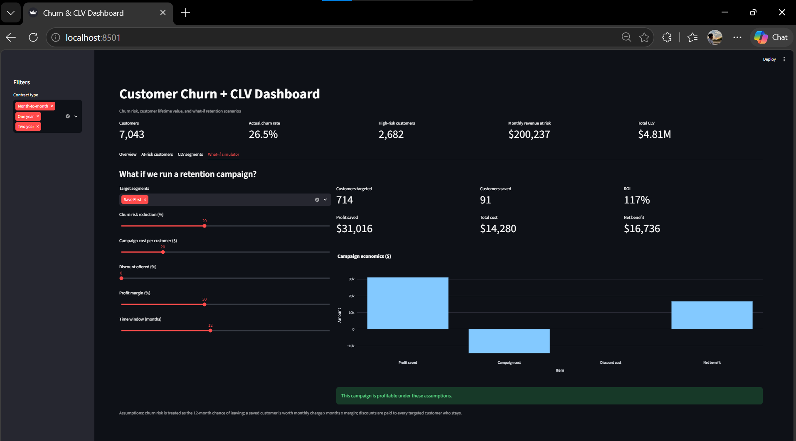
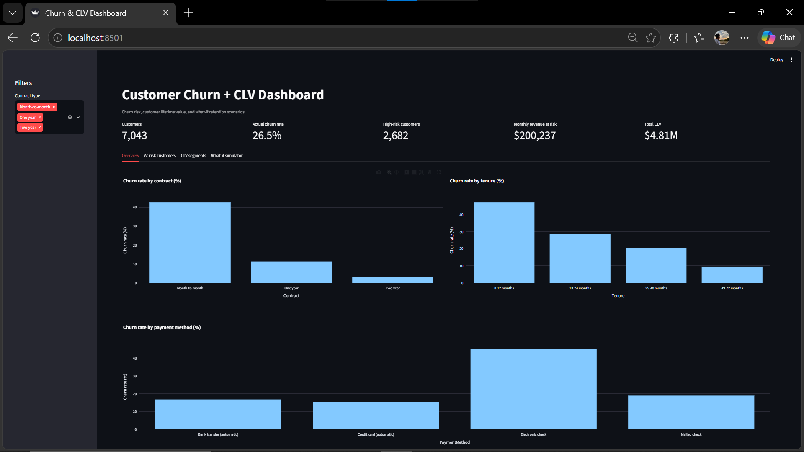
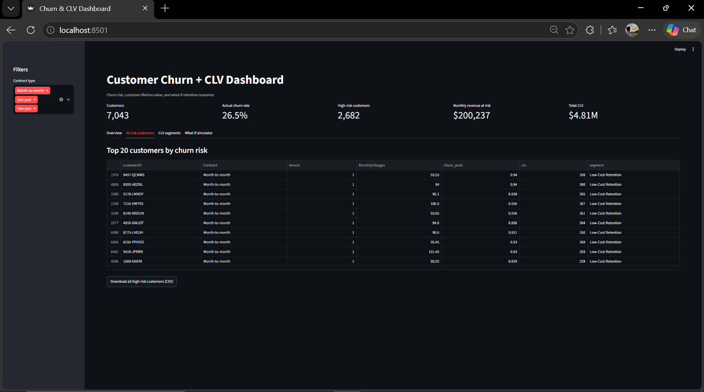
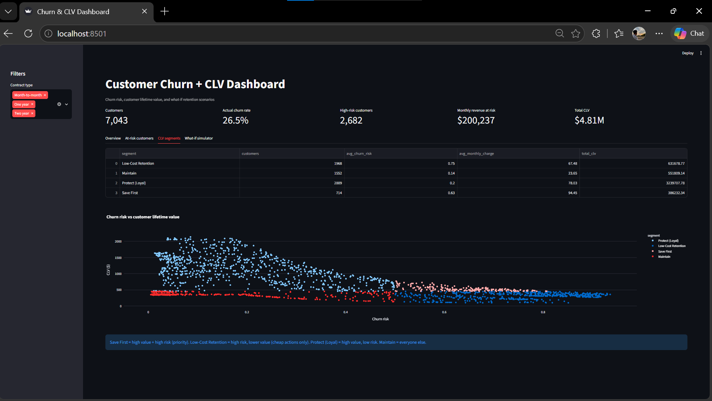

# Customer Churn + CLV Dashboard with What-If Simulation

An end-to-end analytics project that predicts which telecom customers are likely to leave, estimates how much each customer is worth, and simulates the profit impact of retention campaigns.

**Live demo:** https://masood-churn-clv.streamlit.app



## Business problem

Losing customers is expensive, but not every customer is worth saving. This project answers three questions:

1. Who is likely to churn?
2. Which of those customers are worth the most?
3. If we run a retention campaign, does it make money?

## Dataset

Telco Customer Churn (Kaggle, IBM sample data): 7,043 customers, 21 columns, 26.5% churn rate.

## Approach

1. **Cleaning:** fixed `TotalCharges` (text with blanks for new customers), removed duplicates, created a 1/0 churn flag.
2. **Feature engineering:** tenure groups, number of services, average monthly spend, month-to-month flag, auto-pay flag.
3. **Churn model:** compared Logistic Regression and Random Forest with class balancing; picked the best by ROC-AUC on a 20% held-out test set.
4. **CLV:** monthly charge x expected lifetime x profit margin.
5. **Segmentation:** risk x value gives four customer segments.
6. **SQL analysis:** loaded the scored data into SQLite and answered business questions with 8 queries.
7. **What-if simulator:** sliders for churn reduction, campaign cost, discount, margin, and time window.

## Key findings

- Month-to-month customers churn at **42.7%**, versus **2.8%** for two-year contracts.
- Customers in their first year churn at **47.4%**, versus **9.5%** after four years.
- **55.5%** of all churned customers left within their first 12 months.
- Customers paying by electronic check churn at **45.3%**, versus 15-19% for the other payment methods. Automatic payment customers are the most stable.
- The highest-risk customers are new, on month-to-month contracts, with high monthly bills.
- The model's risk bands hold up: customers flagged High churned at **71%**, Medium at **37.6%**, and Low at **4.4%**.
- A targeted campaign on the **Save First** segment (714 customers, 20% risk reduction, $20 per customer) returns about **117% ROI**.
- A broad, cheap campaign on two segments (2,682 customers, $5 per customer, 10% risk reduction) returns about **291% ROI**.
- Adding a 10% discount to the Save First campaign makes it **loss-making** (net benefit about -$22.8k). Discounts only pay off if they cut churn far more than assumed.

## Model results (held-out test set)

| Model | Accuracy | Precision | Recall | ROC-AUC |
|---|---|---|---|---|
| Logistic Regression | 0.733 | 0.498 | 0.791 | 0.842 |
| Random Forest (selected) | 0.765 | 0.541 | 0.765 | 0.842 |

Accuracy alone is misleading here because about 73% of customers do not churn, so recall and ROC-AUC are the main metrics.

## Customer segments

| Segment | Customers | Meaning |
|---|---|---|
| Save First | 714 | High value, high risk: priority for retention offers |
| Low-Cost Retention | 1,968 | High risk, lower value: cheap actions only |
| Protect (Loyal) | 2,809 | High value, low risk: keep them happy |
| Maintain | 1,552 | Low risk, lower value |

## Screenshots





## SQL analysis

The scored data is loaded into SQLite (`data/churn.db`) and analysed with 8 queries in `sql/queries.sql`, covering aggregation, JOINs, CASE WHEN, a window function (`RANK() OVER (PARTITION BY ...)`), subqueries, and HAVING.

Key results:
- 55.5% of all churned customers left within their first 12 months.
- Customers flagged High risk churned at 71%, Medium at 37.6%, and Low at 4.4%.
- Electronic check customers churn at 45.3%, versus 15-19% for other payment methods.
- The SQL results match the pandas results (for example, 42.7% churn for month-to-month contracts), which confirms the numbers.

## Assumptions and limitations

- Churn probability is treated as the 12-month chance of leaving. Class balancing makes scores run high, so treat them as a **risk score**, not an exact probability.
- CLV = monthly charge x expected months (12 / churn risk, capped at 60) x 30% margin. Because CLV depends on churn risk, high-risk customers get shorter lifetimes.
- A saved customer is worth monthly charge x months x margin. Discounts are paid to every targeted customer who stays.
- Customers are scored by a model that saw 80% of them in training, so their scores (and the risk-band results above) are slightly optimistic. Evaluation metrics come from the held-out 20%.
- The data is a single static snapshot in US dollars with no real campaign results, so simulation outputs are estimates.

## Project structure

```
churn-clv-project/
├── app/app.py              # Streamlit dashboard
├── src/                    # cleaning, features, model, CLV, segments, simulation
├── sql/queries.sql         # 8 business queries
├── data/raw/               # original CSV
├── data/processed/         # cleaned and scored data
├── data/churn.db           # SQLite database
├── models/                 # saved model
├── reports/screenshots/    # README images
├── run_pipeline.py         # runs the full backend
├── build_database.py       # loads scored data into SQLite
├── run_queries.py          # runs the SQL queries
├── test_simulation.py      # quick check of the simulation logic
└── requirements.txt
```

## How to run

```
pip install -r requirements.txt
python run_pipeline.py
python build_database.py
python run_queries.py
python -m streamlit run app/app.py
```

## Tech stack

Python, pandas, scikit-learn, SQL (SQLite), Plotly, Streamlit

## Author

YOUR NAME | [GitHub](https://github.com/masoodcodes) | LinkedIn: _add link_

//Press Ctrl + Shift + V